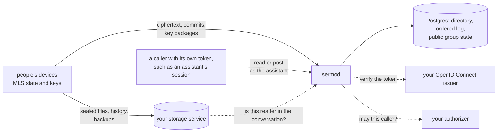

# Sermo

**A server for end-to-end encrypted conversations between people, over
MLS, where an assistant reads a conversation only while its owners let
it in.** People's devices encrypt every message for the members of the
conversation with Messaging Layer Security (RFC 9420). Sermo delivers
the ciphertext in order, keeps the directory of each person's devices
and the keys they offer, and checks every change to a conversation the
way every device does. Files, shared history and backups are sealed on
the devices and kept in a storage service you run, never in Sermo.

An assistant joins a conversation the way a person does: an owner's
device adds its member to the encrypted group, and every member sees
it. While it is a member, Sermo holds that member's keys, sealed, and
decrypts for a caller your authorizer allows. When an owner turns it
off, its member is removed, the keys change, and Sermo destroys every
secret it held for that conversation.

Identity comes from any OpenID Connect issuer. Permission comes from an
endpoint you write.

This repository is the whole service, `sermod`, and anyone can run it.
Versions are `v*` tags, and [CHANGELOG.md](CHANGELOG.md) says what each
one changed.

## What it promises

- What people write is never readable by the server, unless the
  conversation's owners let the assistant in, which every member sees.
- A person's recovery key never reaches the server. A backup is kept
  only as ciphertext, and nothing the operator can do opens it.
- Every change to who is in a conversation, who owns it and whether
  the assistant may read is a commit signed by the member who made it,
  checked by every device and by the server.

The design is in [`specs/`](specs/README.md).

## License

Apache-2.0. See [LICENSE](LICENSE).
