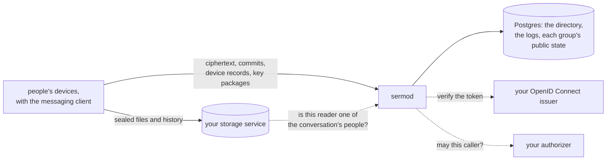

# Sermo

**Sermo is a server for end-to-end encrypted conversations between
people, over Messaging Layer Security (MLS, RFC 9420).** People's
devices encrypt every message for the members of a conversation. Sermo
delivers the ciphertext to each of them in one order, keeps the
directory of each person's devices and the keys they offer, and checks
every change to who is in a conversation the way every device checks
it, so a change an honest device would refuse never reaches the others.
It holds no key that opens what people write. People sign in with any
OpenID Connect issuer, and an authorizer of your own decides who may
reach whom.

This repository is the whole server, `sermod`, and anyone can run it.

[](https://github.com/latere-ai/sermo/actions/workflows/verify.yml)
[](https://github.com/latere-ai/sermo/releases)
[](go.mod)
[](LICENSE)

## Status

The latest release is [v0.2.0](CHANGELOG.md#v020---2026-11-03). Before
1.0, a minor release may change the API under `/v1/messaging`, and the
[changelog](CHANGELOG.md) names every change.

Sermo has had no external security audit, and neither has the MLS code
it and its clients run. [Security](SECURITY.md#audit) says what has
been tested instead.

| | |
|---|---|
| **The directory**: each person's devices, each vouched for by another of theirs, and the revocations that remove them | works, since v0.1.0 |
| **Key packages**: a pool for each device, from which others add it to a conversation | works, since v0.1.0 |
| **Conversations**: an ordered log of MLS messages with one commit per epoch, each commit checked against the conversation's rules before it is kept, Welcomes for added devices, and the group info a device joins from on its own | works, since v0.1.0 |
| **Recovery**: a person's recovery record, their backup key wrapped under the recovery key, and the backup key handed to a new device | works, since v0.1.0 |
| **Backup records**: a person's history, sealed on their devices, read back by a new one | works, since v0.2.0 |
| **Membership answers** for a storage service that serves the files sent in a conversation | works, since v0.1.0 |
| **Postgres**, with any number of replicas over one database; memory for a trial | works, since v0.1.0 |
| **The assistant's member**: an assistant a conversation's owners add as a member, which every member sees, and whose keys the server holds while they let it in | designed, not served: the routes it reads and posts through do not exist yet |
| **Notices**: a content-free signal of a new message, for a push service | designed, not served |

## Quickstart

You need Go 1.27 or newer, `git`, `curl`, `jq`, and Podman or Docker.
This builds `sermod`, starts a local OpenID Connect issuer and the server,
and makes a signed-in request. [Running it locally](docs/local.md) is the
same, step by step.

```sh
git clone https://github.com/latere-ai/sermo && cd sermo
go build -o out/sermod ./cmd/sermod

podman run -d --name sermo-dex -p 127.0.0.1:5556:5556 \
  -v "$PWD/docs/local/dex.yaml:/etc/dex/config.yaml:ro" \
  ghcr.io/dexidp/dex:v2.43.1 dex serve /etc/dex/config.yaml
until curl -fs http://127.0.0.1:5556/dex/.well-known/openid-configuration > /dev/null; do sleep 1; done

SERMO_ADDR=127.0.0.1:8080 SERMO_OIDC_ISSUERS=http://127.0.0.1:5556/dex \
  ./out/sermod > out/sermod.out 2> out/sermod.log &
until curl -fs http://127.0.0.1:8080/readyz > /dev/null; do sleep 1; done

TOKEN=$(curl -s http://127.0.0.1:5556/dex/token -u sermo:local-client-secret \
  -d grant_type=password -d username=alice@example.com -d password=password \
  -d scope=openid | jq -r .id_token)
curl -s http://127.0.0.1:8080/v1/messaging/service -H "Authorization: Bearer $TOKEN"
```

The answer is the server's key as the external sender every
conversation's group names:

```json
{"external_sender":{"signature_key":"...","identity":"service"}}
```

`kill %1` and `podman rm -f sermo-dex` stop both. A conversation itself
is made of signed and encrypted messages that a device's client creates;
[the API](docs/api.md#the-flows) walks through them.

## How it fits



- **Clients.** A device runs
  [`latere.ai/x/sdk-go/messaging`](https://pkg.go.dev/latere.ai/x/sdk-go/messaging),
  over the MLS implementation
  [`latere.ai/x/sdk-go/mls`](https://pkg.go.dev/latere.ai/x/sdk-go/mls).
  Its client calls this API, and its directory and rules are the ones the
  server checks with, so the two cannot disagree.
- **An OpenID Connect issuer** signs the tokens of the people and
  services that call. A person is a token's subject.
- **An authorizer** decides who may talk to whom, and anything else that
  is not for MLS or the conversation's rules to decide. Without one, the
  server decides by a [member policy](docs/authorizer.md#without-an-authorizer).
- **Postgres** keeps everything the server keeps.
- **A storage service** keeps the files sent in conversations, which the
  devices seal; the server keeps none, and answers whether a reader is
  one of a conversation's people.

## Documentation

| | |
|---|---|
| [Running it locally](docs/local.md) | `sermod` on your machine with a local issuer, step by step |
| [Install](docs/install.md) | the image and how to check it, Postgres, the server's key, the probes, and upgrading |
| [Configuration](docs/configuration.md) | every `SERMO_*` variable, its default, and what refuses a start |
| [API](docs/api.md) | the conventions, the flows a device follows, the errors, and the limits |
| [Writing an authorizer](docs/authorizer.md) | the question the server sends, the vocabulary, and the member policy |
| [Security](docs/security.md) | what an installation guarantees, what the server sees, and what an operator keeps safe |

[`docs/README.md`](docs/README.md) is the index, and
[`api/openapi.yaml`](api/openapi.yaml) is the full API reference.

## Contributing

[`CONTRIBUTING.md`](CONTRIBUTING.md) is how to build and test a change,
and where code belongs. [`SECURITY.md`](SECURITY.md) is what the project
protects and how to report a vulnerability; please do not open an issue
for one.

## License

Apache-2.0. See [LICENSE](LICENSE).
