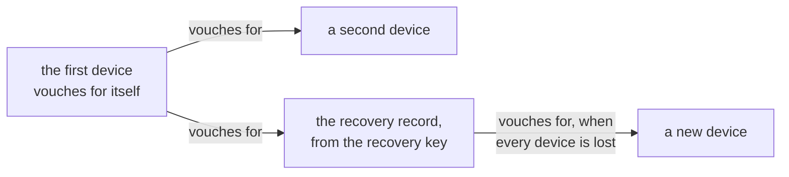
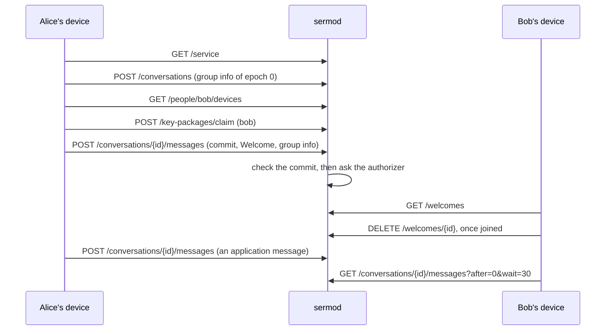
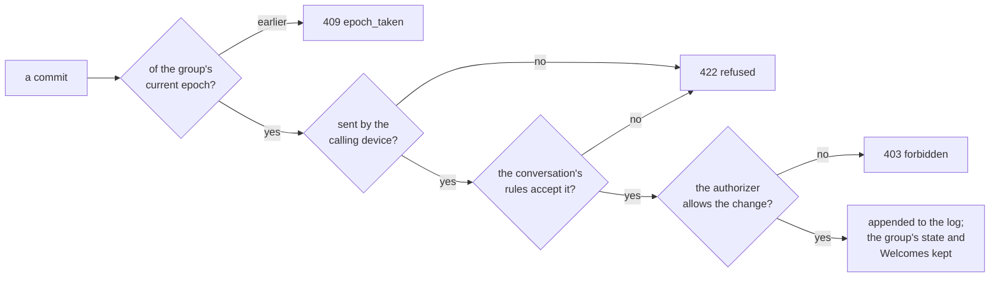

# API

How a device and a service talk to `sermod`: the conventions every
request follows, the flows a client goes through, the errors to branch
on, and the limits. The full reference, every route with its bodies and
answers, is [`api/openapi.yaml`](../api/openapi.yaml), which the server's
tests hold to the routes it serves. `sermod` does not serve the document.

A device rarely calls this API by hand. The Go package
[`latere.ai/x/sdk-go/messaging`](https://pkg.go.dev/latere.ai/x/sdk-go/messaging)
is its client: its `Client` makes each call below, and its `Directory`
and `Policy` verify what the server answers before a device trusts it.

## Conventions

- **Where.** Every route is under `/v1/messaging`.
- **Who.** Every request carries `Authorization: Bearer <token>`, a token
  from an issuer the operator listed, whose audience is the server's. A
  person is the token's `sub` claim, and every `person` in a path or a
  body is that value. The one route that takes no token is
  `GET /v1/messaging/version`.
- **Which device.** A request a device makes as itself names the device
  in `Sermo-Device: <device id>`. The routes that act for a device
  require it; the others check it when it is present. A device that is
  not the caller's, or is revoked, is refused with `403 not_your_device`
  before anything else is asked.
- **Bodies.** Requests and answers are JSON. Bytes, such as an MLS
  message or a public key, are standard base64 with `=` padding. A body
  is one JSON value, and a member the reference does not describe is
  refused with `400 unknown_field`.
- **Pages.** A list takes `limit`, 50 when absent or 0 and 200 at most,
  and answers the cursor of its next page: the conversations list in
  `next`, which is present when the page is full, and the log as the
  sequence number to read `after`.
- **Retries.** Nothing takes an idempotency key. A create sent again
  answers `409 exists`, and a commit sent again after its first send was
  taken answers `409 epoch_taken`: the device reads the log to see that
  the commit is its own.

## The flows

A conversation is one MLS group, and its id, chosen by the device that
creates it, is the group's id. The server keeps the group's public state
and an ordered log of its messages, and checks every change to the group
before it is delivered. The calls below are in the order a client makes
them.

### A device joins its person's directory

A person's devices are records in the directory, each vouched for by
another record of the same person back to a root, a record that vouches
for itself, and each signed by its own key. The server cannot list a key
no device holds or move a record under another root, and every device
verifies a person's directory before it adds them.



1. `PUT /devices/{device}` registers the device's record: its signature
   key, its encryption key, its voucher and the two signatures. The first
   device of a person is a root. Sending the same record again is
   answered as success and changes nothing.
2. `POST /key-packages` publishes a pool of MLS key packages for the
   device, and a last resort that is never used up. `GET /key-packages`
   says how many are left, so the device publishes more before the pool
   runs out.
3. `PUT /recovery` registers the person's recovery record and their
   backup key, wrapped under the recovery key, which the server never
   sees. A new device that holds the recovery key reads it back with
   `GET /recovery`.

A second device is vouched for by a device the person already has, which
hands it the backup key sealed to its encryption key:
`POST /devices/{device}/transfer` leaves it, and the new device takes it,
once, with `GET /devices/{device}/transfer`.

A device the person no longer holds is removed by a revocation, which a
record under the same root signs: `POST /revocations`. The server keeps
it, deletes the device's key packages and its waiting transfer, and
proposes the removal of the device's leaves from every conversation of
the person's. Revoked records stay listed, so the vouches under them
still verify. `GET /people/{person}/devices` lists every record and
revocation of a person, for a device to verify with
`messaging.NewDirectory`.

### A device starts a conversation and adds people



1. `GET /service` answers the server's key and identity as an MLS
   external sender. The group names it before it is created; it is the
   one party besides the members that may propose a change, and it
   proposes nothing but the removal of a revoked device.
2. `POST /conversations` creates the conversation from the group info of
   its epoch 0, with the ratchet tree: the calling device alone, its
   person as the one person and owner, the assistant off, and the
   server as its external sender.
3. To add a person, the device reads and verifies their directory, then
   claims one key package for each of their devices with
   `POST /key-packages/claim`.
4. The commit that adds them is sent to the log with
   `POST /conversations/{id}/messages`, with the Welcome for the devices
   it adds and the group info of the epoch it starts. The server files
   the Welcome for each added device.
5. Each added device lists its Welcomes with `GET /welcomes`, joins from
   one, verifying the group with `messaging.Policy`, and drops it with
   `DELETE /welcomes/{id}`.

A new device of a person who is already in a conversation joins it on
its own: it reads `GET /conversations/{id}/group-info` and sends an
external commit.

### A commit reaches the log

Every proposal and commit is checked before it is kept. The checks are
the ones every device makes, from the same package, so a commit the
server accepts is one every honest device merges.



The first commit of an epoch to pass is the epoch's. Another sent for the
same epoch is answered `409 epoch_taken`, with the current epoch in the
error's detail; the device reads the log, applies the commit that won,
and tries again. The group info sent with a commit must describe the
epoch it starts exactly, so a device that later joins from it joins the
group every member holds.

An application message is appended when its epoch is the group's and the
calling device has a leaf in the group. Its content, and which leaf sent
it, are encrypted.

### Reading the log

`GET /conversations/{id}/messages?after=<seq>` answers the messages after
a sequence number, oldest first, with `next`, the number to read after
next time. With `wait`, up to 30 seconds, the answer waits for a message
when there is none yet, so a device keeps one read open per conversation
and gets each message as it arrives. Messages of epochs the device was
not a member of are passed over and counted in `next`.

### Backup records

A device that joins a conversation can read only what is sent after it
joined. A person's history is kept as sealed records instead: each
device seals every message it sends or reads under the person's backup
key, and stores the records with `POST /conversations/{id}/backup`. A
record's id is derived from the message by the person's devices, so two
devices store one message once and the server cannot tell which message
a record is. `GET /conversations/{id}/backup` lists a person's own
records, oldest after a cursor or newest before it. A person's records
of a conversation they left stay theirs.

### Membership

`GET /conversations/{id}/people/{person}` answers whether a person is one
of a conversation's people now, as `{person, member}`. A storage service
that keeps the files sent in a conversation, sealed on the devices, asks
it before it serves one. It is authorized as `conversation.membership`.

## Errors

A refusal answers one envelope:

```json
{
  "error": {
    "code": "epoch_taken",
    "message": "Someone else changed the conversation first. Try again.",
    "details": {"detail": "the conversation is at epoch 7"}
  }
}
```

Branch on `code`. `message` is one fixed sentence for the code, written
for the person using your app, and the reference lists each. `detail` is
for you, says what was wrong with this request, may be absent, and its
wording may change.

| Code | Status | When |
|---|---|---|
| `invalid` | 400 | The body, a parameter, or what it holds is not what the route takes: a message that is empty, not of the group, or of a later epoch than the group's among them |
| `unknown_field` | 400 | The body has a member the reference does not describe |
| `missing_token` | 401 | No bearer token |
| `invalid_token` | 401 | The token was refused |
| `not_your_device` | 403 | `Sermo-Device` is missing where it is required, or names no device of the caller's that stands |
| `forbidden` | 403 | The authorizer said no; or the caller is not one of the conversation's people, or its device not a leaf of the group, or the device fetches what was left for another |
| `not_found` | 404 | No such object |
| `exists` | 409 | A conversation id is taken; a record's id is registered with other keys, or its key is revoked |
| `epoch_taken` | 409 | A proposal or a commit for an epoch another commit took first |
| `wrong_epoch` | 409 | An application message for an epoch that has ended |
| `too_large` | 413 | The body, a message or a count is over its bound |
| `refused` | 422 | The group's public state or the conversation's rules refuse the commit or the message |
| `internal` | 500 | Anything else |
| `authorizer_unavailable` | 503 | The authorizer gave no answer; worth retrying |

The server sets no rate limit of its own; an authorizer can refuse what
it judges too much.

## Limits

| What | Limit |
|---|---|
| A request body | 8 MiB, or what the operator sets in [`SERMO_MAX_REQUEST_BYTES`](configuration.md#limits) |
| An MLS message | 266240 bytes: the largest padded payload, 256 KiB, and 4 KiB of framing |
| Key packages published in one call | 100 |
| Key packages one device holds | 200 |
| A page of a list | 200, and 50 by default |
| A wait for a message | 30 seconds |
| A conversation's id | 1 to 128 of `A-Z`, `a-z`, `0-9`, `.`, `_`, `~` and `-` |
| A backup record's id | 1 to 64 characters |
| Backup records stored in one call | 20 |
| The backup records of one person, in all | 256 MiB |
| How long a message and a Welcome are kept | 30 days, or what the operator sets in [`SERMO_RETENTION`](configuration.md#limits) |

## The build

`GET /v1/messaging/version` answers the release the server runs, as
`{"version", "commit", "build_time"}`, with no token, so a client can
tell which release it talks to through a proxy that forwards only
`/v1/messaging`.
