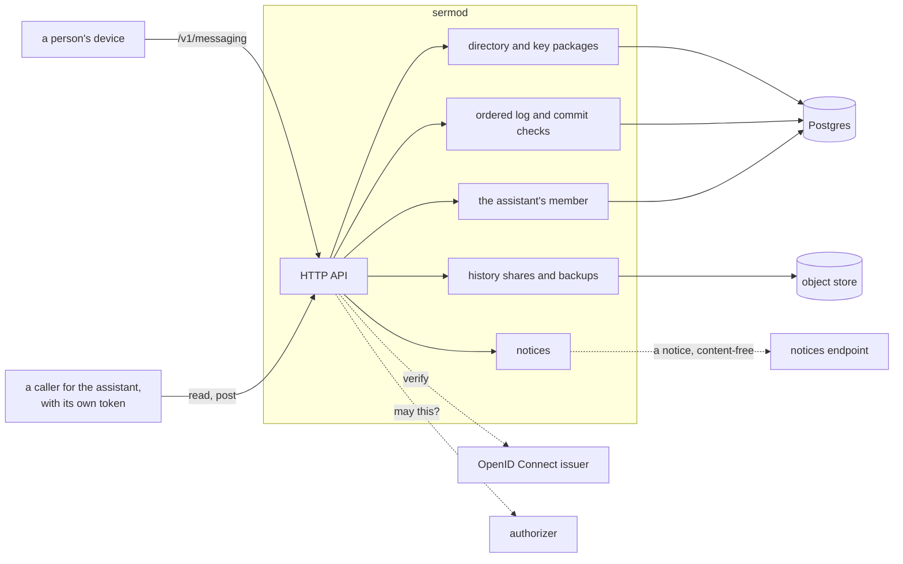

# Architecture

## Overview

Sermo is the server of end-to-end encrypted conversations between
people. Each conversation is one MLS group (RFC 9420). The members'
devices hold every private key; Sermo holds the ciphertext of what they
write, in order, and the public state of each group, and it checks every
change to a group before it delivers it. An assistant takes part in a
conversation only as a member of its group, which an owner adds and
every member sees; while it is a member, Sermo holds that member's keys,
sealed.

Sermo is one binary, `sermod`, with Postgres for the directory, the log
and the groups' public state, an S3 object store for history shares and
backups, an OpenID Connect issuer for identity and an HTTP authorizer
for every decision. It reimplements nothing of MLS: it parses and checks
what devices send with `latere.ai/x/sdk-go/mls`, and applies the
conversation rules of `latere.ai/x/sdk-go/messaging`, the package every
device applies, so a commit the server accepts is a commit every honest
device merges.

## Design

### Components

| Component | Holds | Never |
|---|---|---|
| Directory | Each person's device records, vouched for by another of their own, and their recovery record; revoked records stay, so vouches still verify | A private key |
| Key packages | Each device's pool of one-time key packages and its last resort | The key packages' secrets |
| Log | Every message of a conversation, numbered in one sequence; one commit per epoch, the first to arrive; the group's public state after each commit; the latest group info | A message's plaintext |
| History shares and backups | Sealed bundles and backup records in the object store, and the wrapped backup key | A key that opens them |
| The assistant's member | Its MLS state per conversation, sealed under a data key of that conversation, while the level is not Off | Its state after the level is Off: the data key is destroyed first |

### The profile

What devices and Sermo agree on is fixed in `latere.ai/x/sdk-go/messaging`,
and its formats are named here so a reader of this repository finds them.

| Thing | Value |
|---|---|
| Cipher suite | `MLS_128_DHKEMX25519_AES128GCM_SHA256_Ed25519` (0x0001) alone |
| Handshake messages | PublicMessage, so Sermo reads every proposal and commit |
| Application messages | PrivateMessage, the payload padded to one of 256 B, 1, 4, 16, 64 and 256 KiB |
| A device's credential | basic, `user:<subject>/device:<device id>`, with the device's own Ed25519 key in every group |
| The assistant's credential | basic, `latere/conversation:<conversation id>`, with an attestation leaf extension |
| Conversation state | group context extension 0xF5E0: kind, level, people in join order, owners |
| Attestation | leaf extension 0xF5E1: the installation's Ed25519 signature over the label `latere messaging attestation v1`, the group id and the leaf's signature key |
| Required capabilities | extensions 0xF5E0 and 0xF5E1 |
| External senders | Sermo alone, which proposes removals of people's devices and nothing else |
| Group id | the conversation id's bytes |
| Vouch | an Ed25519 signature over the label `latere messaging vouch v1` and the record |
| History notice | the commit's authenticated data: the range under the exporter label `latere messaging history notice v1`, and for each joining leaf, sealed with EncryptWithLabel `conversation history` to its key package's init key |
| Recovery key | 2 version bits, 128 random bits and a 10-bit check, in 28 characters of Crockford's base32 in seven groups of four |

The assistant's credential and attestation name `latere` because the
messaging package fixes them; an installation signs the attestation with
its own key, which its apps pin.

### Requests and identity

Every request carries a bearer token from the issuer, whose audience is
Sermo's. A person acts as the token's subject. A device names itself in
`Sermo-Device`, and Sermo checks that the device is one of the subject's
before it accepts anything the device signed: a commit's sender leaf
must carry that device's credential and key. A caller for the assistant
presents its own token, and the authorizer decides from the facts Sermo
sends (the conversation's people, owners and level) whether it may read
or post.

### Invariants

1. No plaintext of a message, and no private key of a person, is
   logged, returned, stored or kept in a test fixture. A test plants a
   canary in a message and searches every log line, response and table
   for it.
2. Sermo accepts a commit only if `messaging.Policy.CheckCommit` accepts
   it against the group's public state of that epoch, and the
   authorizer allows the change it reports.
3. One commit per epoch: the first that passes is the epoch's, and a
   later one for the same epoch is answered `409 epoch_taken`.
4. The assistant's member decrypts only for a caller the authorizer
   allows, and turning it off destroys its data key before anything
   else.
5. The object store holds only what devices sealed.

## Acceptance criteria

1. A message's plaintext planted as a canary is found in no log line,
   response or table after a conversation is created, written in,
   shared into and backed up.
2. A commit `messaging.Policy.CheckCommit` refuses is answered
   `422 refused` and changes nothing.
3. Two commits for one epoch: the first is accepted, the second is
   answered `409 epoch_taken`, and every device sees the first.
4. After the level goes to Off, Sermo holds no secret of the group and
   its data key is gone.
