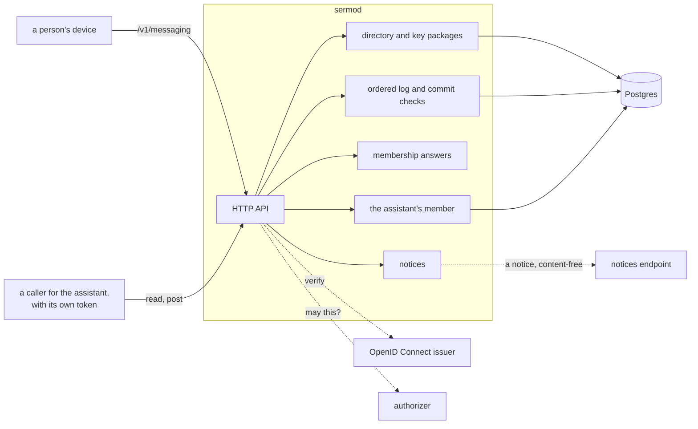

# Architecture

## Overview

Sermo is the server of end-to-end encrypted conversations between
people. Each conversation is one MLS group (RFC 9420). The members'
devices hold every private key; Sermo holds the ciphertext of what they
write, in order, and the public state of each group, and it checks every
change to a group before it delivers it. An assistant takes part in a
conversation only as a member of its group, which an owner adds and
every member sees; while it is a member, Sermo holds that member's keys,
sealed.

Sermo is one binary, `sermod`, with Postgres for the directory, the log
and the groups' public state, an OpenID Connect issuer for identity and
an HTTP authorizer for every decision. It keeps no file: what devices
seal for a conversation, its attachments and history bundles, and each
person's backup, is in a storage service the plane runs. It reimplements nothing of MLS: it parses and checks
what devices send with `latere.ai/x/sdk-go/mls`, and applies the
conversation rules of `latere.ai/x/sdk-go/messaging`, the package every
device applies, so a commit the server accepts is a commit every honest
device merges.

## Design

### Components

| Component | Holds | Never |
|---|---|---|
| Directory | Each person's device records, vouched for by another of their own, and their recovery record; revoked records stay, so vouches still verify | A private key |
| Key packages | Each device's pool of one-time key packages and its last resort | The key packages' secrets |
| Log | Every message of a conversation, numbered in one sequence; one commit per epoch, the first to arrive; the group's public state after each commit; the latest group info | A message's plaintext |
| Recovery | Each person's recovery record and wrapped backup key, and a backup key sealed to a new device until it fetches it | A key that opens them |
| The assistant's member | Its MLS state per conversation, sealed under a data key of that conversation, while the level is not Off | Its state after the level is Off: the data key is destroyed first |

### The profile

What devices and Sermo agree on is fixed in `latere.ai/x/sdk-go/messaging`,
and its formats are named here so a reader of this repository finds them.

| Thing | Value |
|---|---|
| Cipher suite | `MLS_128_DHKEMX25519_AES128GCM_SHA256_Ed25519` (0x0001) alone |
| Handshake messages | PublicMessage, so Sermo reads every proposal and commit |
| Application messages | PrivateMessage, the payload padded to one of 256 B, 1, 4, 16, 64 and 256 KiB |
| A device's credential | basic, `user:<subject>/device:<device id>`, with the device's own Ed25519 key in every group |
| The assistant's credential | basic, `latere/conversation:<conversation id>`, with an attestation leaf extension |
| Conversation state | group context extension 0xF5E0: kind, level, people in join order, owners |
| Attestation | leaf extension 0xF5E1: the installation's Ed25519 signature over the label `latere messaging attestation v1`, the group id and the leaf's signature key |
| Required capabilities | extensions 0xF5E0 and 0xF5E1 |
| External senders | Sermo alone, which proposes removals of people's devices and nothing else |
| Group id | the conversation id's bytes |
| Vouch | an Ed25519 signature by the voucher over the label `latere messaging vouch v1` and the record, which names its voucher's id and key |
| Possession | an Ed25519 signature by the record's own key over the label `latere messaging possession v1` and the same record |
| Revocation | an Ed25519 signature over the label `latere messaging revocation v1`, the key revoked and the keys it keeps |
| History notice | the commit's authenticated data: the range under the exporter label `latere messaging history notice v1`, and for each joining leaf, sealed with EncryptWithLabel `conversation history` to its key package's init key |
| Recovery key | 2 version bits, 128 random bits and a 10-bit check, in 28 characters of Crockford's base32 in seven groups of four |
| Commit notice digest | a Welcome extension in the group info the committer signs, binding a joiner to the notice the commit carries |

The assistant's credential and attestation name `latere` because the
messaging package fixes them; an installation signs the attestation with
its own key, which its apps pin.

### The directory

A person's devices are records, each vouched for by another record of
the same person back to a root, a record that vouches for itself, and
signed by its own key over the record and the voucher it names, so
Sermo cannot list a key no device holds or move a record under another
root. Sermo stores what devices send and serves it; every device
verifies it with `messaging.NewDirectory`, and Sermo uses the same
function to decide what it accepts:

- A record is taken when `Directory.CheckRecord` passes and it stands
  among the person's other records. A record a revoked key vouches for
  is never taken, since a revocation may keep a key before any record
  holds it. A person has at most `messaging.MaxRecords` records.
- A revocation is signed by a record under the same root as the key it
  revokes and names the records the key vouched for that stay; two
  revocations of one key keep only what both name, so a dispute
  between a person and a thief fails closed. Sermo keeps a revocation
  only when `Directory.CheckRevocation` says it changes what stands,
  which bounds a person's revocations by `messaging.MaxRevocations`.
- On every revocation Sermo proposes, as the external sender, the
  removal of each leaf with the revoked key from each of the person's
  conversations, and proposes nothing else. Revoked records stay, so
  the vouches under them still verify.

A device takes a group it joins only when every leaf is a device that
stands in its person's directory, or the assistant's member attested by
the installation, and when a person's device signed the group info it
joins from. Sermo applies the same check, `messaging.Policy.CheckJoin`,
to the group a conversation starts with.

### What Sermo cannot check

A handshake message's membership tag and a commit's confirmation tag
are computed with the epoch's secrets, which only members hold. Sermo
checks every commit's signature and rules, takes the first that passes
as the epoch's, and delivers it. A member can send a commit whose tags
are wrong: Sermo takes it, every other member refuses it, and the
conversation can go no further, since its epoch is taken. The commit
names its sender, whose signature Sermo checked; the owners start a new
conversation without them. A member can do this only to a conversation
it is in.

### Requests and identity

Every request carries a bearer token from the issuer, whose audience is
Sermo's. A person is the token's `sub`. A device names itself in
`Sermo-Device`, and Sermo checks that the device is one of the subject's
before it accepts anything the device signed: a commit's sender leaf
must carry that device's credential and key. A caller for the assistant
presents its own token, and the authorizer decides from the facts Sermo
sends (the conversation's people, owners and level) whether it may read
or post.

### Invariants

1. No plaintext of a message, and no private key of a person, is
   logged, returned, stored or kept in a test fixture. A test plants a
   canary in a message and searches every log line, response and table
   for it.
2. Sermo accepts a commit only if `messaging.Policy.CheckCommit` accepts
   it against the group's public state of that epoch, and the
   authorizer allows the change it reports.
3. One commit per epoch: the first that passes is the epoch's, and a
   later one for the same epoch is answered `409 epoch_taken`.
4. The assistant's member decrypts only for a caller the authorizer
   allows, and turning it off destroys its data key before anything
   else.
5. Sermo keeps no file. A device seals each attachment, history bundle
   and backup record and keeps the ciphertext in a storage service the
   plane runs, which asks Sermo, through `conversation.membership`,
   whether a reader is one of a conversation's people.

## Acceptance criteria

1. A message's plaintext planted as a canary is found in no log line,
   response or table after a conversation is created, written in,
   shared into and backed up.
2. A commit `messaging.Policy.CheckCommit` refuses is answered
   `422 refused` and changes nothing.
3. Two commits for one epoch: the first is accepted, the second is
   answered `409 epoch_taken`, and every device sees the first.
4. After the level goes to Off, Sermo holds no secret of the group and
   its data key is gone.
