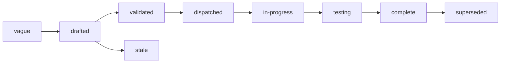

# Specs

Design specs for Sermo, a server for end-to-end encrypted conversations
between people over MLS: the objects a conversation is made of, the API
a device and a caller code against, the directory of devices and who
vouches for them, the ordered log and the checks on every commit, the
history a joining member is given, the backup a person's recovery key
unlocks, and the assistant's member, the one place the server holds a
member's keys. One spec covers one component. Each states the problem,
the design with enough precision to build from, and acceptance criteria
that are testable statements.

## Layout

Flat files `specs/NNN-name.md` in one number space with `track: core`
in the frontmatter. Numbers are stable identifiers and are never
reused. Open specs sit here and are the work queue. A terminal spec
moves to `specs/.archive/` keeping its number so `depends_on` paths
still resolve.

## Index

The specs are being written.

| # | Spec | Effort | Status | Builds on |
|---|---|---|---|---|
